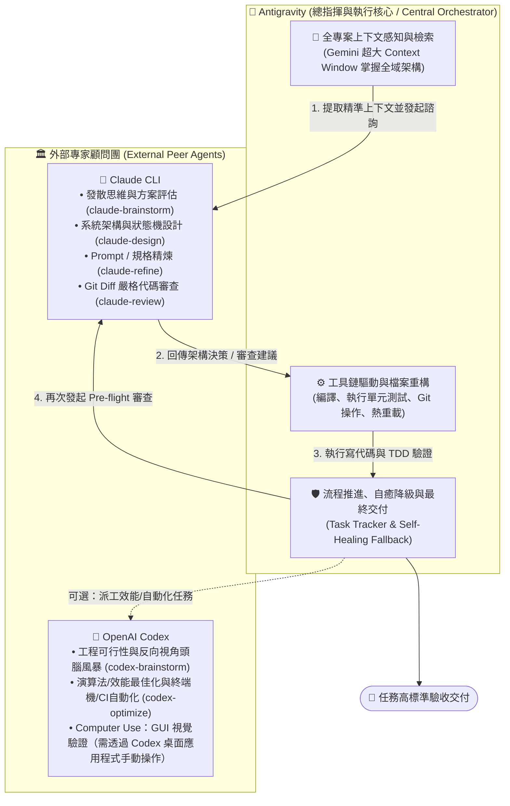
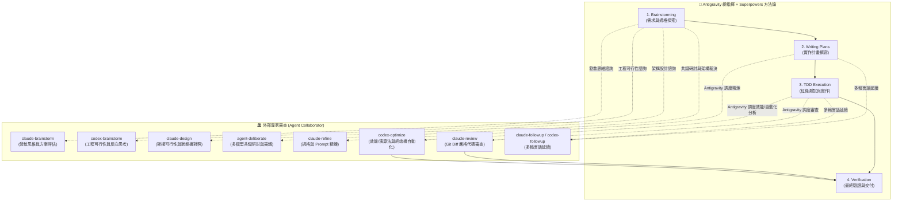

# 🤝 Agent Collaborator (多代理人協同架構 Skill & CLI)

> **以 Antigravity 作為總指揮核心（Central Orchestrator），調度 Claude CLI / OpenAI Codex 外部專家的多代理人深度協作與交叉驗證系統。**
> 具備自動優雅降級（Graceful Fallback）、模組化安裝與 Superpowers 工作流無縫整合。

[English Documentation](README.md)

---

## 🌟 核心分工：Antigravity 作為總指揮 (Orchestrator Architecture)

在現代軟體工程中，單一模型往往難以同時兼顧「全域專案感知」與「嚴苛的局部邏輯推理」。

`agent-collaborator` 的核心架構是由 **Google Antigravity (Gemini)** 擔任**總指揮官與主執行者（Central Orchestrator & Implementer）**，並在關鍵決策節點主動調度 **Claude CLI / Codex 等外部專家（Peer Experts）**：



### 為什麼由 Antigravity 擔任總指揮？
1. **龐大的上下文吞吐量（Context Capacity）**：Antigravity 具備強大的全專案跨檔案檢索與上下文組裝能力，能精確為外部專家準備最相關的程式碼切片。
2. **完整的工具鏈執行權限（Toolchain Orchestration）**：Antigravity 原生支援終端命令執行、測試套件驗收、檔案增刪與版本控制。
3. **主動協調與容錯能力（Active Coordination & Fallback）**：Antigravity 負責維護任務清單與推進狀態，當外部專家 API 額度用盡或連線異常時，Antigravity 會自動無縫接管，確保工作流永不中斷。

---

## ⚡ 核心能力與指令

安裝後，您可以直接在終端機使用（或由 Antigravity 自動調度調用）：

| 指令 / 腳本 | 用途 | 使用範例 |
| :--- | :--- | :--- |
| **`claude-brainstorm`** | 發散式頭腦風暴、2-3 種架構方案對照、邊界風險與權衡評估 | `claude-brainstorm [--model <model>] [-c] "<需求描述>" [上下文檔案...]` |
| **`codex-brainstorm`** | 工程可行性分析、標準庫/生態替代方案、極簡可行架構與反向思考 | `codex-brainstorm [--model <model>] [-c] "<需求描述>" [上下文檔案...]` |
| **`claude-design`** | 系統架構、狀態機、組件邊界與深度技術規格設計 | `claude-design [--model <model>] [-c] "<需求描述>" [上下文檔案...]` |
| **`claude-refine`** | Prompt、JSON Schema、規格文件專項精煉優化（可注入參考檔案） | `claude-refine [--model <model>] [-c] "<目標檔案>" "<優化目標>" [參考檔案...]` |
| **`claude-review`** | Git Diff 審查、防範 Crash、邏輯漏洞與回歸風險 | `claude-review [--model <model>] [-c] [BASE_REF] "<任務背景描述>"` |
| **`claude-followup`** | 多輪會話接續，沿用當前目錄的 Claude 既有對話上下文 | `claude-followup [--model <model>] "<追問或生成指令>" [上下文檔案...]` |
| **`codex-followup`** | 多輪會話接續，恢復當前目錄的最新 Codex 會話 (`resume --last`) | `codex-followup [--model <model>] "<追問或生成指令>" [上下文檔案...]` |
| **`codex-optimize`** | 演算法複雜度/效能瓶頸分析、終端機與 CI 自動化 | `codex-optimize [--model <model>] [-c] "<任務或需求>" [上下文檔案...]` |
| **`agent-deliberate`** | 多模型環狀共識研討，具備結構化指標表、Option 0 基線、YAGNI 否決權與會話接續 | `agent-deliberate [OPTIONS] "<議題>" [檔案...]`<br/>`agent-deliberate -c [--dir <目錄>] [--guidance "<指引>"]` |
| **`consensus-round`** | 單輪並行研討執行驅動腳本，具備模型階梯與引導注入 | `consensus-round [OPTIONS] "<研討目錄>" <輪次>` |

### 🎛️ 動態模型切換與任務分級
所有腳本皆支援即時切換模型，具備三層優先級規則：
1. **CLI 參數最優先**：`--model <name>` 或 `-m <name>`（例如 `claude-brainstorm --model haiku "..."` 或 `codex-optimize -m o3-mini "..."`）
2. **環境變數次之**：Claude 系列使用 `CLAUDE_MODEL`，Codex 系列使用 `CODEX_MODEL`，或使用 `AGENT_MODEL` 作為全域後備（例如 `CLAUDE_MODEL=opus claude-design "..."`）
3. **原生預設（無指定）**：直接沿用底層 `claude` 或 `codex` CLI 目前配置的預設模型。

這讓 Antigravity 可以自主依任務複雜度分級調度：小型 Prompt 調整與簡易審查調用輕快省 Token 的模型（如 `haiku`、`o3-mini`），而關鍵系統架構與上線前安全審核則使用頂級旗艦模型（如 `sonnet`、`opus`、`o3`）。

#### 🪜 自主模型階梯退避 (Autonomous Model Fallback Ladder)
在共識研討或工具執行時，若指定模型遭遇 API 速率限制（HTTP 429）或帳號層級不支援（HTTP 400，如 ChatGPT 帳號在 Codex CLI 的模型限制），腳本將自動沿著備用階梯依序重試，確保研討不中斷：
- **Claude CLI**：`sonnet` ➔ `haiku`
- **Codex CLI**：`gpt-5.6-luna` ➔ `gpt-5.6-terra` ➔ `o3-mini` ➔ 原生預設
*(可透過 `LADDER_CLAUDE` 與 `LADDER_CODEX` 環境變數自訂)*

### 🔄 多輪協作延續與記憶防幻覺規範 (Multi-Turn Collaboration Protocol)
外部 Peer Agent CLI **預設為無狀態 (Stateless)**！總指揮嚴格禁止在沒有延續上下文的情況下，發起如 `claude -p "依據剛才的 Review 結論..."` 這類憑空預設模型記得前言的指令。
- **同模型多輪延續 (In-Agent Continuity)**：需在當前目錄繼續討論或生成文件時，使用 `claude-followup` / `codex-followup`，或在既有工具附加 `-c` / `--continue`。
- **跨模型成果匯整 (Cross-Agent Context Piping)**：Claude 與 Codex 的 Session 完全獨立不互通！跨模型協同（例如匯總 Codex 筆記與 Claude 審查以生成最終設計）時，**必須**使用顯式檔案注入，直接將參考成果傳入 `claude-refine <目標> "<目標描述>" [參考檔案...]` 或 `claude-design` 的上下文參數。

### 🏛️ 多模型環狀共識研討 (`agent-deliberate` 與 `consensus-round`)

當面臨重大架構取捨、分歧的實作提案或高風險技術決策時，透過環狀拓撲結構在 Claude（架構師與邊界獵人）與 Codex（務實紅隊與 YAGNI 看門狗）之間發起嚴謹辯論，由 Antigravity 擔任中立主持人，並由 Jetski 提供實證測試支援。

#### 1. 環狀拓撲與角色分工
- **Antigravity (Gemini - 研討主持人 / Neutral Host)**：定義討論主題、候選方案與強制性 **Option 0** 極簡基線；生成每輪匿名摘要 (`digest.md`)；以確定性 `jq` 計分規則客觀統計投票；在達成共識時生成最終架構藍圖 (`final_blueprint.md`)。不參與投票以避免主觀偏見。
- **Claude CLI (架構師與邊界獵人 / Architect & Edge-Case Hunter)**：評估系統拓撲、模組邊界、正規狀態機、故障隔離與回歸預防。
- **OpenAI Codex CLI (務實紅隊與 YAGNI 看門狗 / Pragmatic Red Team & YAGNI Watchdog)**：審查程式碼簡約度、標準庫替代方案、效能效率與過度架構風險，堅決剔除無效抽象。
- **Jetski Native Subagent (實證測試探針 / Empirical Spike Probe)**：當模型雙方出現事實性爭議或 API / 效能假設分歧時，自動生成實證指引 (`jetski_evidence_prompt.md`) 執行即用即丟的測試或基準探針，以客觀事實終結爭辯。

#### 2. 結構化指標評分表與防過度架構否決權 (Parsimony Veto)
所有投票模型皆依據五大核心維度進行評分（1 至 5 分）：
1. `technical_feasibility`（技術可行性）：方案能否在現有作業系統、CLI、執行階段與 API 約束下運作，無未證實的假設。
2. `architectural_simplicity`（架構簡潔性）：組件是否解耦且能獨立理解，杜絕循環相依。
3. `yagni_and_parsimony`（YAGNI 極簡主義 / 反過度設計）：嚴格的設計經濟性；每一行抽象皆須為具體需求服務。
4. `robustness_failure_modes`（穩健性與故障模式）：逾時、部分故障、錯誤碼與狀態一致性是否處理得當。
5. `maintainability_testability`（可維護性與可測試性）：能否以自動化測試驗證，無需繁複測試裝具。

- **強制性 Option 0 MVA 極簡基線**：第 1 輪必須定義 `Option_0`（利用原生/OS 原語且無投機抽象的極簡可行架構）。任何替代方案皆承擔複雜度成本，必須證明 Option 0 之不足。
- **極簡主義一票否決權 (Parsimony Veto)**：任何提案若平均 `yagni_and_parsimony` 得分低於 `3.5`，或存在未解決的 `over_architecture_flags`，立即喪失共識資格。提案方必須在下一輪簡化架構，或證明其嚴格必要性。
- **動態反向提案合成 (Counter-Proposal Synthesis)**：當模型投下 `BLOCK` 阻擋票並提出替代架構時，系統會自動將其結構化並動態註冊至後續輪次的候選方案中。

#### 3. CLI 指令與參數範例
```bash
# 全新發起共識研討（最多執行 N 輪）：
agent-deliberate [--rounds 3] [--model-claude <model>] [--model-codex <model>] "<議題或需求>" [上下文檔案...]

# 預先註冊候選方案：
agent-deliberate --add-option "Option_A: SQLite 狀態帳本" --add-option "Option_B: 記憶體環狀緩衝" "<議題>" [上下文檔案...]

# 在 DEADLOCK 或 IN_DEBATE 狀態下接續研討：
agent-deliberate -c [--dir <目錄> | --id <ID>] [--guidance "<人類指引>"] [--add-option "<新方案>"]

# 範例：注入人類操作員指引打破僵局：
agent-deliberate -c --id dlb-20261025-abcd --guidance "採納 Option_A，但改用輕量 JSON Schema 驗證，不引入重型 ORM"

# 單輪並行研討驅動腳本（底層指令）：
consensus-round [OPTIONS] <研討目錄> <輪次>
```

#### 4. 僵局處理與共識收斂
- **確定性共識門檻 (`CONVERGED`)**：所有投票模型一致選出相同偏好方案、無任何未解決的 `BLOCK` 阻擋票、五大指標評分極差 $\le 1.0$，且平均 YAGNI 分數 $\ge 3.5$。達成時生成 `final_blueprint.md`。
- **有限輪次終止機制 (`DEADLOCK`)**：若在 `MAX_ROUNDS`（預設 3 輪）內未能達成共識，程序安全終止為 `DEADLOCK`，印出互動式僵局回報，並生成 `dissent_register.md` 完整記錄無法調和的權衡與事實異議。
- **會話接續與人類介入 (`-c`)**：人類工程師或總指揮可檢視 `dissent_register.md`，使用 `--guidance "<指引>"` 注入決策傾向，並透過 `agent-deliberate -c` 接續研討，歷史選票與輪次摘要完全保留。

---

## 🧩 Claude CLI 與 OpenAI Codex：如何選擇

兩者都是真正能寫代碼的 Agent，本專案依各自實際強項分派任務：

| 強項 | Claude CLI | OpenAI Codex |
| :--- | :--- | :--- |
| 發散式頭腦風暴與多方案權衡 | ✅ 主力（`claude-brainstorm`）| — |
| 工程可行性評估與極簡可行架構 | — | ✅ 主力（`codex-brainstorm`）|
| 跨檔案深度架構 / 長上下文推理 | ✅ 主力（`claude-design`）| — |
| 嚴謹、重視安全性的代碼審查 | ✅ 主力（`claude-review`）| — |
| 規格 / Prompt / Schema 精煉 | ✅ 主力（`claude-refine`）| — |
| 終端機、Shell 與 CI Pipeline 自動化 | — | ✅ 領先（Terminal-Bench 類基準表現佳）|
| 演算法 / 效能瓶頸最佳化 | — | ✅ 主力（`codex-optimize`）|
| 大量、終端機導向任務的單次成本 | — | ✅ 通常耗用 Token 更少 |
| **Computer Use**：透過螢幕感知與滑鼠/鍵盤操作真實 GUI 應用（瀏覽器、Figma、Xcode、Slack 等）| — | ✅ 原生支援，但僅限 **Codex 桌面 / ChatGPT 應用程式**，非無頭 CLI |

Computer Use 確實是 Codex 的真實強項之一，但它是互動式、依賴螢幕操作的能力——本專案的腳本皆為非互動 / 無頭模式 (`codex exec`)，因此 `codex-optimize` 無法驅動 GUI。當任務真的需要視覺 / GUI 驗證時（例如「這個變更在 Figma / 瀏覽器裡實際渲染是否正確？」），總指揮應明確說明，並交由人類操作員或 Codex 桌面應用程式處理，而非假裝無頭腳本能夠完成。

---

## 🔄 雙模態運作支援：獨立模式 vs Superpowers 整合模式

Agent Collaborator 具備**自適應雙模態相容設計**：

1. **獨立模式（預設 / Standalone Mode）**：
   - 無需安裝 Superpowers 即可獨立運作（執行 `./install.sh --all` 或 `./install.sh --project <path>`）。
   - 專注於多模型專家智囊審查與交付前驗證（`claude-design`, `claude-review`, `claude-refine`, `codex-optimize`）。
   - 總指揮採用原生內建推理進行標準計畫與除錯。**若環境沒有安裝 Superpowers，系統絕不會報錯或中斷任務**。
2. **Superpowers 整合模式（雙引擎架構 / Dual-Engine）**：
   - 將 Superpowers 的嚴格工程生命週期（頭腦風暴、規格先行、TDD 先紅後綠、系統性除錯、交付前驗證）與 Agent Collaborator 外部 Peer 智囊團完美結合。
   - 執行 `./install.sh --with-superpowers`（或手動安裝外掛）即可啟用。
   - **技術保證機制**：
     - **Claude Code**：透過 `superpowers` 外掛的 `SessionStart` Hook，在會話啟動時硬性注入技能調用約束。
     - **Antigravity (Gemini)**：透過 `AGENTS.md` / `GEMINI.md` 的 **常駐系統規則（Always-Active Rules）**，每一輪工程決策皆強制遵守。
3. **任務邊界定義（工程任務 vs 純資訊問答）**：
   - **實質工程任務**（撰寫/修改程式碼、設計功能、修復 Bug、重構）：嚴格強制執行 Superpowers 與 Peer Review。
   - **純資訊與概念問答**（例如：*「這行 code 是什麼意思？」*、*「介紹一下專案架構」*、*「Dart 語法怎麼寫？」*）：**明確予以豁免**，直接精準回覆，不觸發繁瑣流程。

---

## 🚀 一、 安裝 Superpowers (可選雙引擎方法論框架)

若您希望讓 Agent 具備完整的工程方法論（規格設計、TDD、實作計畫），`install.sh` 可以幫您自動安裝：

```bash
./install.sh --with-superpowers
```

此指令會偵測 `PATH` 上有哪個驅動 CLI（Antigravity 用 `agy`，Claude Code 用 `claude`），並執行其外掛安裝指令；可與其他任何選項組合，例如 `./install.sh --project . --with-superpowers`。

若手動安裝：
* **Antigravity**：
  ```bash
  agy plugin install https://github.com/obra/superpowers
  ```
* **Claude Code**（需在 Claude Code session 內執行）：
  ```text
  /plugin install superpowers@claude-plugins-official
  ```

---

## 🚀 二、 安裝 Agent Collaborator

### 1. 取得專案並執行安裝

```bash
git clone https://github.com/gogog22510/agent-collaborator.git
cd agent-collaborator
./install.sh
```

### 2. 選擇安裝模式

```text
======================================================
  🤝 Agent Collaborator Universal Installer
======================================================
Select an installation target:
  1) All (CLI Tools + Antigravity Global + Claude Code Global) [推薦全裝]
  2) Standalone CLI Tools only (~/.local/bin/claude-design, ...)
  3) Antigravity Global Skills (~/.gemini/...)
  4) Project-Local Skill (.agent/skills/ in current directory)
  5) Claude Code Global Skills (~/.claude/skills/)
  6) Install Superpowers methodology plugin (Antigravity / Claude Code)
```

### 非互動旗標（CI / 自動化腳本）
* **全裝**：`./install.sh --all`
* **僅 CLI**：`./install.sh --cli`（symlink 到 `~/.local/bin/`）
* **Antigravity Global**：`./install.sh --antigravity-global`（安裝至 `~/.gemini/skills/` 並同步 `~/.gemini/config/AGENTS.md`）
* **Project Local**：`./install.sh --project /path/to/project`（安裝至 `.agent/skills/` 與 `.claude/skills/`，並就地注入/更新 `/path/to/project/AGENTS.md`；加 `--no-agents-md` 可跳過協議注入步驟）
* **Superpowers**：`./install.sh --with-superpowers`（可獨立使用，也可與上述任一選項組合）

> **就地更新 (In-Place Updates)**：`--project` 會在 `<!-- agent-collaborator:protocol:start -->` 與 `<!-- agent-collaborator:protocol:end -->` 標記間進行**就地安全替換更新**，完整保留您在 `AGENTS.md` 內原有的任何自訂規則。同時會自動檢查並清理 `.agent/skills/` 內舊版重複的 Superpowers 檔案，確保全域外掛正常運作不產生版本漂移。

---

## 🌟 三、 Superpowers + Antigravity 總指揮流水線

當 Superpowers 結合 Antigravity + Agent Collaborator 時，每個階段都能達成雙模型把關：



---

## 📖 各環境配置範本 (Integration Templates)

詳細配置指引請參閱 `templates/` 目錄：
* ⚡ **Superpowers / Antigravity 整合**：[`templates/antigravity_superpowers.md`](templates/antigravity_superpowers.md)
* 🤖 **Claude Code 整合**：[`templates/claude_code.md`](templates/claude_code.md)

---

## 🛡️ 自動優雅降級機制 (Graceful Self-Healing Fallback)

### Antigravity 沙盒環境注意 (Sandbox Handling)
外部 Peer Agent 工具 (`claude-brainstorm`, `claude-design`, `claude-refine`, `claude-review`, `claude-followup`, `codex-brainstorm`, `codex-optimize`, `codex-followup`, `agent-deliberate`, `consensus-round`) 需調用 Host 端本機二進位執行檔 (`~/.local/bin/claude`, `~/.local/bin/codex`) 以及連線至外部 API：
- **`BypassSandbox: true` 必備**：在 Antigravity 透過 `run_command` 調用外部 Agent 時，必須加上 `BypassSandbox: true`。
- **沙盒權限阻擋 (Exit 126)**：若在預設 Sandbox 內執行，會返回 `❌ [SANDBOX_BLOCKED] (Exit: 126)`。指揮官將補上 `BypassSandbox: true` 重新嘗試一次（若依然失敗則轉為內部推理降級，避免無限重試循環）。

### 調用端參數與對話狀態錯誤 (Exit 1)
若腳本返回 Exit Code `1`（缺少必要參數、指定上下文檔案不存在、或找不到可接續的歷史對話）：代表調用端輸入問題，**並非**外部 API 故障。指揮官應修正參數、檢查檔案路徑、或以全新對話（不帶 `-c`）執行，**不得**誤觸發降級。

### 真正的 API 額度 / 斷線降級 (Exit 100)
當外部 Agent 遇到 API 額度用盡 (Usage Limit)、Rate Limit (429) 或連線超載 (529) 時，腳本會自動輸出 `⚠️ [FALLBACK_TRIGGERED: ...]`（Exit Code: `100`），總指揮（Antigravity）會無縫接管架構或審查工作，**絕不中斷任務流水線**。

---

## 📄 開源授權 (License)

本專案採用 [MIT License](LICENSE) 授權。
