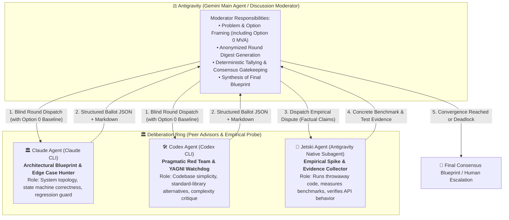
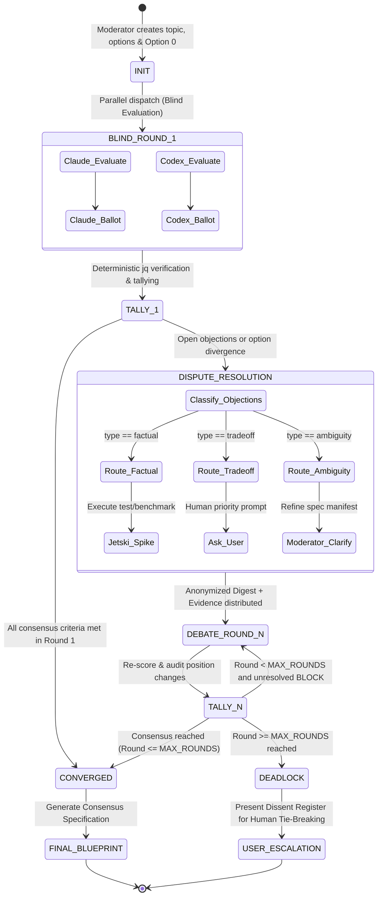

# Multi-Agent Consensus Deliberation Architecture Specification

- **Document Version**: 1.0.0
- **Status**: Validated Design (Draft -> Spec)
- **Author**: Antigravity (Gemini Orchestrator) in consultation with Claude (Architecture Peer)
- **Target Repo**: `agent-collaborator`
- **Date**: 2026-10-14

---

## 1. Background & Motivation

The current `agent-collaborator` architecture operates primarily as a **hub-and-spoke consultation protocol**:
The Central Orchestrator (Antigravity / Gemini) invokes individual peer tools (`claude-brainstorm`, `codex-brainstorm`, `claude-design`, `claude-review`, etc.) in isolation, receives their unilateral output, and synthesizes the decision internally.

While effective for single-angle advice, this pattern has several architectural limitations:
1. **Lack of Peer Cross-Examination**: Claude's high-level architectural proposals and Codex's pragmatic engineering/performance assessments do not directly confront or stress-test each other.
2. **Subjective Convergence**: Consensus is evaluated purely through internal Orchestrator heuristics rather than a structured, falsifiable metric framework.
3. **Risk of Over-Architecture**: Autonomous LLMs frequently introduce excessive abstractions, speculative extension points, and unnecessary state management without empirical justification.

This document specifies a new operational mode: **Multi-Agent Consensus Deliberation (`agent-deliberate`)**. In this mode, Antigravity acts as the Moderator/Orchestrator leading a multi-turn, ring-structured debate among **Claude CLI**, **Codex CLI**, and **Jetski Subagent (Antigravity's Empirical Spike Agent)** evaluated against a **Structured Metric Table**, with built-in **Over-Architecture (YAGNI) Veto** and guaranteed bounded termination.

---

## 2. System Architecture & Role Topology



### 2.1 Participant Roles & Responsibilities

| Agent | Platform / Invocation | Primary Responsibilities | Independence & Voting Rules |
|---|---|---|---|
| **Antigravity (Main Agent)** | Gemini Central Orchestrator | Deliberation host, round framing, anonymized digest synthesis, gate evaluation. | **Neutral Host**: Does not cast a subjective vote in peer rounds to avoid confirmation bias. |
| **Claude Agent** | `claude` CLI via `claude-deliberate` | High-level system architecture, module boundaries, formal state machines, failure modes. | **Independent Voting Peer**: Full ballot scoring and blocking objection power. |
| **Codex Agent** | `codex` CLI via `codex-deliberate` | Engineering pragmatism, memory/CPU efficiency, terminal automation, YAGNI enforcement. | **Independent Voting Peer / Red Team**: Mandated to challenge complexity and audit over-architecture. |
| **Jetski Agent** | Native Antigravity Subagent (`invoke_subagent`) | Ground truth verification, throwaway spikes, benchmark runs, codebase metric audits. | **Empirical Evidence Collector**: Does not vote subjectively (prevents Gemini double-voting); resolves `factual` disputes with real test code. |

---

## 3. Structured Metric Table & Ballot Schema

Every voting agent in every round outputs a machine-verifiable JSON block enclosed in a code fence, accompanied by an executive summary in Markdown.

### 3.1 JSON Ballot Schema

```json
{
  "$schema": "https://json-schema.org/draft/2020-12/schema",
  "deliberation_id": "dlb-YYYYMMDD-XXXX",
  "round": 1,
  "agent": "claude | codex",
  "model": "string",
  "preferred_option": "Option_0 | Option_A | Option_B",
  "stance": "ACCEPT | ACCEPT_WITH_RESERVATIONS | BLOCK",
  "metrics": {
    "technical_feasibility": {
      "score": 5,
      "confidence": 0.9,
      "rationale": "Directly supported by standard POSIX tools and existing CLI wrappers."
    },
    "architectural_simplicity": {
      "score": 4,
      "confidence": 0.85,
      "rationale": "Uses existing filesystem directory conventions; avoids daemon overhead."
    },
    "yagni_and_parsimony": {
      "score": 4,
      "confidence": 0.9,
      "cognitive_overhead": "LOW",
      "indirection_layers": 1,
      "rationale": "No speculative abstractions or plugin hooks added."
    },
    "robustness_failure_modes": {
      "score": 4,
      "confidence": 0.8,
      "rationale": "Handles timeout, sandbox blocks (exit 126), and quota limits (exit 100)."
    },
    "maintainability_testability": {
      "score": 5,
      "confidence": 0.9,
      "rationale": "Each round is fully recorded as a static JSON/MD ledger in .agent/deliberations/."
    }
  },
  "over_architecture_flags": [
    {
      "pattern": "PREMATURE_GENERALIZATION | UNNECESSARY_PERSISTENCE | EXCESSIVE_INDIRECTION | SPECULATIVE_CONFIG",
      "critique": "Detailed critique of unnecessary complexity in proposed options",
      "simplification_remedy": "Concrete drop-in replacement using simpler primitives"
    }
  ],
  "blocking_objections": [
    {
      "id": "OBJ-1",
      "type": "factual | tradeoff | ambiguity",
      "metric_target": "yagni_and_parsimony",
      "claim": "Option B introduces a background daemon which is unnecessary for a batch CLI.",
      "resolution_condition": "Remove daemon and run purely in-process or via batch script."
    }
  ],
  "position_changes": [
    {
      "from_option": "Option_B",
      "to_option": "Option_A",
      "cited_objection_ids": ["OBJ-2"],
      "justification": "Accepted Codex's argument regarding race conditions on concurrent file writes."
    }
  ]
}
```

### 3.2 Metric Definitions & Scoring Rubric

All scores are integers from `1` (Unacceptable / Dangerous / Severely Bloated) to `5` (Exemplary / Production Grade / Minimalist):

1. **`technical_feasibility`**: Does the solution work within current OS, CLI, runtime, and API limits without undocumented assumptions?
2. **`architectural_simplicity`**: Are components decoupled, understandable in isolation, and free of circular dependencies?
3. **`yagni_and_parsimony` (The Anti-Overarchitecture Metric)**:
   - Evaluates whether every line of abstraction directly serves an active requirement.
   - `5`: Minimal viable architecture (MVA) using native language/OS primitives.
   - `3`: Acceptable indirection justified by concrete failure handling.
   - `< 3`: **Trigger for Automatic Over-Architecture Veto (`BLOCK`)**.
4. **`robustness_failure_modes`**: Are timeout, partial failure, rate limits, exit codes (0/1/100/126), and state corruptions handled cleanly?
5. **`maintainability_testability`**: Can this design be verified with automated unit/integration tests without complex test harnesses?

---

## 4. Anti-Overarchitecture & Parsimony Protocol

To prevent multi-agent deliberations from spiraling into architectural bloat, the deliberation protocol enforces four structural constraints:

### 4.1 Option 0: Mandatory Minimal Viable Architecture (MVA) Baseline
In Round 1, the Moderator **MUST** define `Option_0`: the most barebones, naive, functional implementation possible (e.g. single script, standard library, in-memory state, zero external dependencies).
- Every alternative proposal (`Option_A`, `Option_B`) bears a **Complexity Tax**.
- Any agent advocating for a non-zero option must demonstrate: *What specific, critical production failure occurs if Option 0 is selected?*

### 4.2 The Parsimony Veto Gate
- Any proposal whose `yagni_and_parsimony` score is below `3.0` from any voting peer is disqualified from consensus.
- If an agent registers an `over_architecture_flags` with `pattern: PREMATURE_GENERALIZATION`, the proponent agent must either:
  1. Concede and remove the speculative layer in the next round, OR
  2. Prove that the requirement cannot be met without it.

### 4.3 Jetski Codebase Footprint Probe
When agents dispute whether an abstraction is "too complex" or "essential for maintainability":
- Jetski executes a throwaway spike measuring:
  - **Lines of Code (LOC) Ratio**: Option proposal vs Option 0 baseline.
  - **Dependency Footprint**: Additional binary/package dependencies introduced.
  - **Call-Stack Depth**: Number of layers traversed to execute the primary happy path.
- The concrete metrics are fed into the Round Digest as objective evidence.

---

## 5. Deliberation Lifecycle & Convergence State Machine

The deliberation proceeds through a deterministic state machine guaranteed to terminate within `MAX_ROUNDS` (default: 3).



### 5.1 Round Progression Rules

1. **Round 1 (Blind Evaluation)**:
   - Neither Claude nor Codex sees each other's scores or arguments. This eliminates anchoring bias and herd mentality (sycophancy).
2. **Round 2+ (Targeted Debate & Anonymized Digest)**:
   - The Moderator generates `digest.md` summarizing the disagreements.
   - Arguments are anonymized as `Agent A` and `Agent B` to prevent model prestige bias.
   - Proponents of differing options must address specific objection IDs (`OBJ-X`).
   - If an agent changes its preferred option, it must cite the specific argument that changed its stance. Changes without justification are flagged as `SUSPECTED_CONFORMITY`.
3. **Dispute Resolution Channels**:
   - `factual`: Assigned to Jetski for automated test/benchmark verification.
   - `tradeoff`: Presented to the user via interactive question to settle the business priority.
   - `ambiguity`: Addressed immediately by the Moderator by clarifying the manifest.

### 5.2 Deterministic Convergence Gate (`CONVERGED`)

Consensus is declared **if and only if** all four conditions are met:
1. **Unanimous Preferred Option**: All independent voting peers select the identical `preferred_option`.
2. **Zero Open Blocks**: `stance != "BLOCK"` across all valid voting ballots.
3. **Score Spread Bound**: For the chosen option, the spread $(\max(\text{score}) - \min(\text{score})) \le 1$ across all core metrics.
4. **YAGNI Compliance**: The chosen option has an average `yagni_and_parsimony` score $\ge 3.5$, with zero unaddressed `over_architecture_flags`.

### 5.3 Bounded Termination & Escalation (`DEADLOCK`)
- If consensus is not achieved after `MAX_ROUNDS` (3 rounds):
  - The process exits with state `DEADLOCK`.
  - A `dissent_register.md` is compiled detailing the exact points of irreconcilable disagreement, option trade-offs, and empirical spike data.
  - The decision is escalated to the Human Operator with an explicit multi-choice question.

---

## 6. Storage & Deliberation Ledger Specification

Deliberations are stored in an auditable filesystem ledger under `.agent/deliberations/<deliberation_id>/`. This ensures complete session persistence and enables Git tracking.

```text
.agent/deliberations/dlb-YYYYMMDD-XXXX/
├── manifest.json              # Topic, options, metrics, MAX_ROUNDS, status
├── option_0_baseline.md       # Mandatory Minimal Viable Architecture baseline
├── round-1/
│   ├── claude_ballot.json     # Machine-readable ballot
│   ├── claude_ballot.md       # Human-readable rationale
│   ├── codex_ballot.json
│   ├── codex_ballot.md
│   ├── tally.json             # Deterministic jq scoring evaluation
│   └── digest.md              # Anonymized summary for Round 2
├── round-2/
│   ├── jetski_evidence.md     # Empirical spike benchmark output
│   ├── claude_ballot.json
│   ├── codex_ballot.json
│   └── tally.json
├── dissent_register.md        # Unresolved disagreements (if Deadlock)
└── final_blueprint.md         # Final consensus design and implementation roadmap
```

---

## 7. CLI Toolchain & Script Architecture

To ensure 100% compatibility with Antigravity's asynchronous coordination protocol and eliminate race conditions:

### 7.1 Single-Task Round Driver (`consensus_round.sh`)
Instead of spawning multiple separate background commands from Antigravity, a unified driver script executes peer evaluations concurrently in a subshell:

```bash
# Invocation syntax
consensus_round.sh [--max-rounds <n>] [--model-claude <m>] [--model-codex <m>] "<DELIBERATION_ID>" "<ROUND_NUM>"
```

**Driver Behavior**:
1. Creates isolated working directories for Claude and Codex session storage.
2. Runs `claude` and `codex` concurrently in the background (`&`), capturing stdout/stderr to temporary files.
3. Performs a single `wait` for both processes.
4. Validates JSON schemas using `jq`.
5. Computes tally, score spreads, and consensus state.
6. Writes `tally.json` and returns exit code `0`.

**Antigravity Benefit**:
One round = exactly ONE background command = exactly ONE reactive wake-up turn!

### 7.2 Standalone CLI Wrapper (`agent-deliberate`)
Added to `~/.local/bin/agent-deliberate` and linked by `install.sh`:
```bash
agent-deliberate [--rounds 3] "Topic or Requirement" [CONTEXT_FILES...]
```

---

## 8. Graceful Fallback & Degradation Protocol

In accordance with Section 6 of `AGENTS.md`:
1. **Single Peer Failure (Exit Code 100 / Quota Exhaustion)**:
   - If Claude or Codex encounters rate limits or API outage, the round driver marks the missing peer as `STATUS: DEGRADED`.
   - The remaining peer continues deliberation.
   - The final output is explicitly tagged `STATUS: CONVERGED_WITH_DEGRADATION (SINGLE_PEER)`.
   - **Crucial Rule**: Antigravity internal reasoning votes are marked `"independent": false` and **DO NOT** count towards peer consensus to prevent simulated agreement.
2. **Total Peer Outage**:
   - If both external peers fail, deliberation falls back cleanly to Antigravity's internal Superpowers brainstorming mode with an explicit alert to the user.
3. **Sandbox Restriction (Exit Code 126)**:
   - Driver flags the command to be re-run with `BypassSandbox: true`.

---

## 9. Verification & Test Plan

1. **Schema Validation Test**: Validate that Claude and Codex output valid JSON conforming to `$schema` using sample prompts.
2. **YAGNI Veto Unit Test**: Feed a deliberately over-engineered proposal (e.g. distributed event queue for local logging) and verify that Codex or Claude triggers `over_architecture_flags` and `stance: BLOCK`.
3. **Single Wake-Up Async Test**: Verify that `consensus_round.sh` runs both peers concurrently, completes in 15–30s, and emits a single notification to Antigravity.
4. **Deadlock & Escalation Test**: Verify that when two peers stubbornly disagree on a tradeoff across 3 rounds, the loop cleanly terminates at `MAX_ROUNDS` and produces a readable `dissent_register.md`.
5. **End-to-End Golden Deliberation**: Run `agent-deliberate` on a real architectural feature in this repository.

---

## 10. Summary of Architectural Guarantees

| Requirement | Architectural Guarantee |
|---|---|
| **Multi-Agent Discussion** | Antigravity coordinates Claude, Codex, and Jetski in structured, multi-turn deliberative rounds. |
| **Structured Metric Table** | 5 core metrics with strict scoring rubric, confidence intervals, and machine-readable JSON schema. |
| **Over-Architecture Guard** | Mandatory Option 0 MVA baseline, YAGNI score threshold $\ge 3.5$, and Parsimony Veto. |
| **Bounded Termination** | Deterministic consensus rules and hard stop at `MAX_ROUNDS = 3` with human escalation. |
| **No Race Conditions** | Single-driver script fan-out yields exactly one background task and reactive wake-up per round. |
| **Empirical Truth** | Jetski acts as an empirical test probe rather than a duplicate voter to settle factual disputes with code. |
